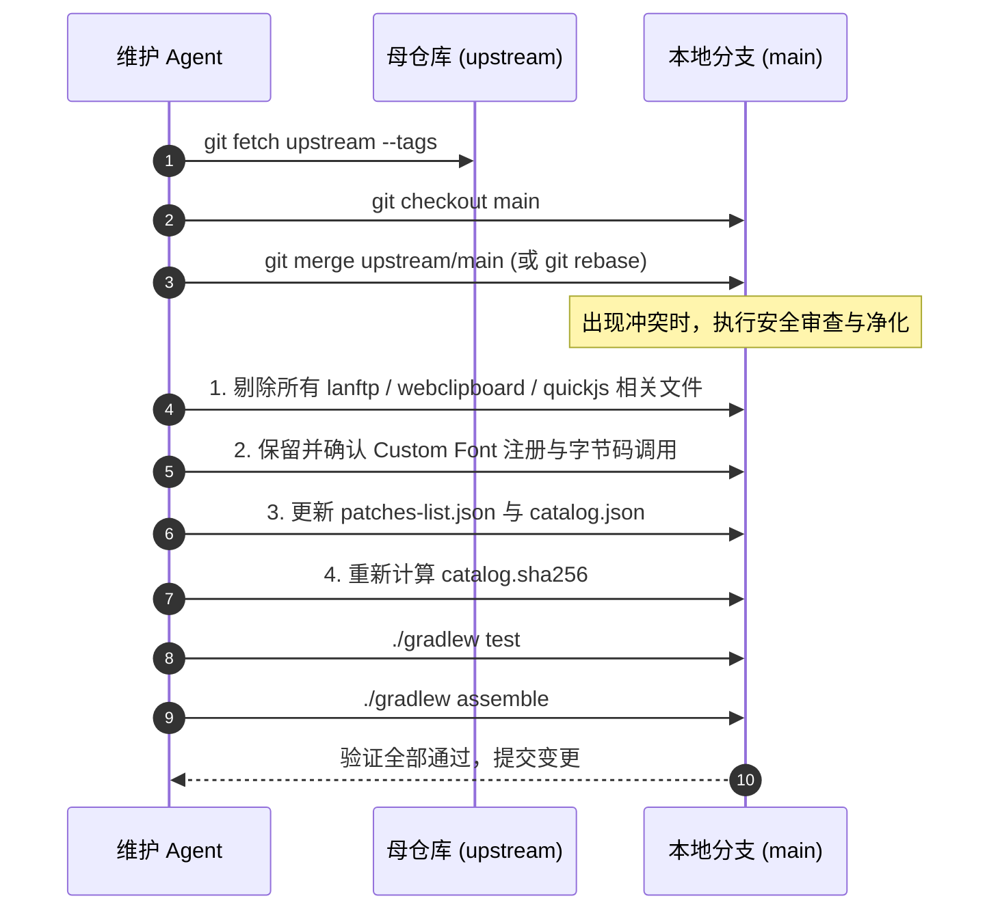

# Gboard-patches Fork 维护与长期演进指南 (FORK_MAINTENANCE_GUIDE)

> **适用对象**：后续接手此项目的任何 AI Agent、自动化工作流或人类维护者。
> **核心原则**：保持与母仓库（Upstream）同步演进；恪守**绝对隐私安全（零网络泄露）**；长期维护并强化**自定义字体与 Emoji 回退**等自有特色功能。

---

## 1. 仓库定位与架构差异矩阵 (Architecture Delta)

* **母仓库（Upstream）**：`https://github.com/jasonwu1994/Gboard-patches` (由 Jason Wu 维护)
* **本 Fork 仓库**：以母仓库为主干，专为**高隐私安全性**与**个性化输入体验**量身定制的纯净版 Morphe Patch。

### 核心特性对比表

| 功能模块 | 母仓库 (Upstream) | 本 Fork 仓库 (Aa-creat) | 说明与安全考量 |
| :--- | :---: | :---: | :--- |
| **Gboard 版本支持** | 18.5.4 (及后续版本) | 18.5.4 (完全同步) | 紧跟母仓库官方目标绑定与字节码适配 |
| **Web Clipboard (网页剪贴板)** | 包含 (本地 HTTP 服务) | ❌ **彻底移除** | 消除开辟本地 Web 服务被局域网嗅探剪贴板的风险 |
| **LAN FTP Server (局域网 FTP)** | 包含 (Apache MINA/FTP) | ❌ **彻底移除** | 消除输入法后台监听端口及全盘文件读写风险 |
| **QuickJS 本地网络脚本** | 包含 (`.so` 及 HTTP 请求) | ❌ **彻底移除** | 顶排快捷栏仅保留纯本地文本短语输入，不执行外部代码 |
| **Custom Font & Modern Emoji** | 无 | ✨ **核心自有功能** | 应用内切换字体、全局/仅Emoji模式、解决按键与Emoji豆腐块 |
| **网络与后台服务权限** | 包含网络/前台服务 | 🔒 **极简化/纯离线** | 不向 Manifest 注入多余的常驻后台传输服务与网络监听服务 |

---

## 2. 隐私安全红线 (Privacy & Security Baseline)

后续在合并或更新任何母仓库提交时，**必须无条件遵守以下安全红线**：

1. **严禁引入任何网络通信服务库**：
   - 严禁引入 Apache FTPServer、Apache MINA、NanoHTTPD、Netty 等网络服务框架。
   - 严禁引入含有网络请求能力的脚本引擎（如带网络扩展的 QuickJS 原生库 `libgboardpatches_quickjs.so`）。
2. **严禁在 AndroidManifest.xml 中暴露数据传输组件**：
   - 不得声明 `LanFtpService`、`LanFtpTileService`、`ClipboardSyncService`、`WebClipboardTileService`。
   - 不得为剪贴板监听器添加未经隔离的网络端口转发。
3. **功能离线化准则**：
   - 顶排滑动栏（Top Row Swipe）：允许用户自定义常用短语与符号，但按压 Action 必须限制为纯文本提交（`PlainTextAction`），杜绝 JS 脚本执行与网络请求。

---

## 3. 自有核心功能清单 (Custom Features Inventory)

### ✨ Custom Font & Modern Emoji（自定义字体与新版 Emoji）

#### 业务价值
解决各品牌定制系统（MIUI、OriginOS、ColorOS、EMUI 等）系统字体 Emoji 缺失、黑白豆腐块（tofu）问题，允许用户在 Gboard Patches 设置中动态导入并应用 `.ttf` / `.otf` 字体（如 AppleColorEmoji、NotoColorEmoji 等），或在打包时预置字体。

#### 代码拓扑与关键组件
* **字节码补丁 (Bytecode Patches)**:
  - `patches/.../features/font/GboardCustomFontPatch.kt`:
    - 拦截 `AutoCenterScaleTextView` 的 `setTypeface` 与 `onDraw`。
    - 拦截 `SoftKeyboardView.onAttachedToWindow`，初始化按键字体。
    - 拦截 `SoftKeyView.q(ILjava/lang/CharSequence;)`，直接注入按键字形。
    - 拦截 `EmojiView.h()` 与构造函数，以及 Emoji 渲染器（`Lnts;`）中的 `TextPaint`，替换 Typeface。
  - `patches/.../features/font/GboardCustomFontFeatureMarkerPatch.kt`: 注入功能标记。
* **扩展运行时 (Extension Runtime)**:
  - `extensions/.../extension/font/GboardCustomFontRuntime.java`: 字体加载缓存、Emoji 范围检测、Typeface 回退逻辑。
  - `extensions/.../extension/font/GboardCustomFontSettings.java`: 存储字体路径、Emoji-only 开关、字体缩放配置。
  - `extensions/.../extension/font/GboardCustomFontSettingsFeature.java`: 设置页 UI、文件选择器与字体预览。
* **生命周期挂载点**:
  - `GboardKeyboardLayoutSettingsGroupFeature.java`: 挂载设置入口至“键盘布局”分组。
  - `GboardFlagStoreColdStartInitializer.java`: 冷启动时触发 `GboardCustomFontRuntime.applyCustomFont(context)`。
  - `RuntimeAbi.kt`: 定义 5 个专属 ABI 调度标识符（`CUSTOM_FONT_RUNTIME_*`）。

---

## 4. 上游版本迭代标准化同步 SOP (Upstream Sync SOP)

当母仓库（`jasonwu1994/Gboard-patches`）发布支持新版 Gboard（如 18.6+ 或更高级别）的更新时，请严格按以下步骤推进：



### 步骤详解

#### 步骤 1：获取上游最新变更
```powershell
& "D:\Program Files\Git\cmd\git.exe" fetch upstream --tags
```

#### 步骤 2：对齐基础
在 `main` 分支合并或挑拣上游最新版本（如 `v4.x.y` 或新 commit）。

#### 步骤 3：安全净化审查（自动/半自动处理冲突）
1. **删除新增或修改的敏感文件**：
   如果上游修改了 `lanftp` 或 `webclipboard` 相关文件，直接执行 `git rm -rf` 将其彻底移除。
2. **清理配置与构建脚本**：
   - `extensions/extension/build.gradle.kts`: 确保不包含 `org.apache.ftpserver`、`org.apache.mina` 依赖及 QuickJS 构建任务。
   - `GboardClipboardSettingsFeature.java`: 确保不包含 Web Clipboard 导航子项。
   - `GboardTopRowSwipeRuntime.java`: 确保仅执行纯文本插入，不执行任何 JS 引擎调用。
3. **维护字体补丁挂载**：
   - 检查 `GboardPatchRegistry.kt` 是否包含 `gboardCustomFontPatch`。
   - 检查 `RuntimeAbi.kt` 是否包含 `CUSTOM_FONT_RUNTIME_*`。
   - 检查 `GboardKeyboardLayoutSettingsGroupFeature.java` 是否包含字体设置入口。

#### 步骤 4：元数据与产品目录同步
1. **更新 `patches-list.json`**：确保 `Custom Font & Modern Emoji` 在列表中，且兼容版本数组包含最新 Gboard 版本。
2. **更新 `gboard-port-product-catalog.json`**：确认 `custom_font` 条目完整。
3. **更新校验和**：
   ```powershell
   (Get-FileHash -Path "patches\src\main\resources\gboard\gboard-port-product-catalog.json" -Algorithm SHA256).Hash.ToLower() | Out-File -Encoding ascii -NoNewline "patches\src\main\resources\gboard\gboard-port-product-catalog.sha256"
   ```

#### 步骤 5：自动化校验
```powershell
# 1. 运行所有单元与契约测试
.\gradlew test --continue

# 2. 构建 Patch Bundle 产物
.\gradlew assemble
```

---

## 5. 常见陷阱与避坑指南 (Troubleshooting)

1. **命名空间与 XML 属性重复 (`Attribute already specified`)**：
   - Gboard 官方 split manifest 在某些解包后不是 namespace-aware 的。对 XML element 增删属性时，必须统一使用 `dev.jason.gboardpatches.patches.gboard.shared.GboardManifestXmlUtilsKt` 中的 `setManifestAndroidAttribute` / `removeManifestAndroidAttribute`，避免抛出 `SAXParseException`。
2. **Catalog 校验失败 (`sha256 mismatch`)**：
   - 只要改动了 `gboard-port-product-catalog.json`，必须立即重新生成 `gboard-port-product-catalog.sha256`。文件内必须纯小写、无额外空行或 BOM 头。
3. **新版本 Gboard 类混淆变化**：
   - 若 Gboard 升级导致类名改变，先在 `gboard-xxx/dex` 中检索核心类（如 `SoftKeyView`、`AutoCenterScaleTextView`、`EmojiView`）。
   - `GboardCustomFontPatch.kt` 采用候选类名列表设计（如 `AUTO_CENTER_SCALE_TEXT_VIEW_CANDIDATES`），只需向列表追加新版本的包名或类名即可平滑兼容。
